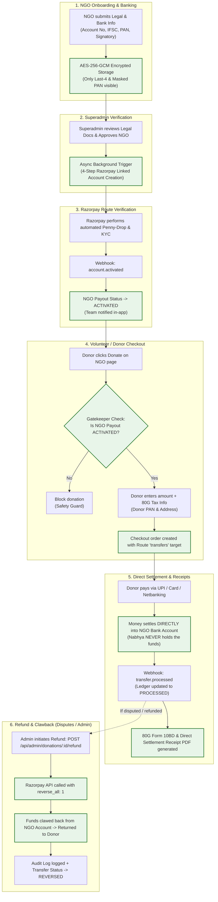

# Razorpay Route Direct Settlement Architecture & Flow

This document details the direct-settlement payment architecture built for Nabhya using **Razorpay Route**. It illustrates the user journey, regulatory compliance mechanisms (Indian 80G Form 10BD), and how our implementation resolved critical financial and security gaps.

---

## 1. High-Level Flowchart



---

## 2. Core Problem & Gap Analysis

Before this implementation, Nabhya had several foundational gaps in its donation and financial architecture:

| Area | The Original Problem (Gap) | Our Implementation (Gap Filled) |
|---|---|---|
| **Fund Custody & Compliance** | Donations were collected into Nabhya's master Razorpay account. Holding public donation funds without an Escrow/Payment Aggregator license violates Indian financial regulations. | Orders attach a `transfers` block targeting the NGO's linked account. **100% of donor funds settle directly into the NGO's bank account**. Nabhya never touches or holds donor money. |
| **Banking Data Security** | Bank details were not handled. Storing raw bank accounts on the `organizations` table would leak them to public profiles via `GET /organizations/:id`. | Created an isolated `organization_payout_profiles` table. Bank account numbers are **encrypted at rest using AES-256-GCM**. Responses return only masked numbers (`•••• 1098`) and masked PANs. |
| **Account Onboarding** | NGOs had no path to register their bank account, and the platform had no integration with Razorpay's linked account APIs. | Built a 4-step onboarding pipeline (`POST /v1/accounts`, stakeholders, Route products, and settlements) triggered asynchronously upon superadmin verification. |
| **Verification & Feedback** | Account verification state was unknown, leading to silent failures. | Webhook state machine listens to `account.activated`, `account.needs_clarification`, and `account.rejected`, instantly notifying the NGO team. |
| **80G Tax Compliance** | Receipts stated "Nabhya collects on behalf" and lacked donor identification, failing Indian Income Tax Form 10BD requirements. | Checkout captures optional 80G tax claims (`donorPan`, `donorAddress`). Receipts generate Form 10BD compliance notes and confirm direct settlement. |
| **Refunds & Disputes** | Refunding a payment left the NGO with the settlement, causing the platform account to absorb 100% of the loss. | Admin refund API invokes Razorpay with `reverse_all: 1`, simultaneously clawing back the settlement from the linked bank account. |

---

## 3. Detailed Step-by-Step Flow

### Stage 1: NGO Banking & KYC Profile Submission
* **Actor:** NGO Administrator (`role: organisation`).
* **Endpoint:** `POST /api/org/payout`
* **Process:**  
  1. The NGO provides legal entity name, entity type (`trust`, `society`, `section8`), organization PAN, bank account number (with confirmation match), IFSC code, and primary signatory KYC details.
  2. The server encrypts the raw bank account number using **AES-256-GCM** (random 96-bit IV, 128-bit authentication tag) via `apps/server/src/common/crypto/encryption.ts`.
  3. The row is inserted into `organization_payout_profiles` with status `SUBMITTED`.
  4. The client receives a masked DTO containing only `bankAccountLast4` and `panMasked`. Plaintext account numbers are destroyed from memory.

### Stage 2: Superadmin Approval & Automated Route Onboarding
* **Actor:** Platform Superadmin (`role: superadmin`).
* **Endpoint:** `PATCH /api/admin/organizations/:id/verification`
* **Process:**  
  1. Superadmin verifies legal NGO registration documents.
  2. When status becomes `VERIFIED`, `admin.service.ts` fires `void this.payoutsService.startOnboarding(organizationId)` as an un-awaited background process.
  3. The service executes Razorpay Route's 4-step onboarding:
     - **Step 1:** `POST /v1/accounts` (creates linked account).
     - **Step 2:** `POST /v1/accounts/{id}/stakeholders` (submits signatory details).
     - **Step 3:** `POST /v1/accounts/{id}/products` (requests Route product).
     - **Step 4:** `PATCH /v1/accounts/{id}/products/{productId}` (decrypts bank account in-flight and links it).
  4. Status transitions to `UNDER_REVIEW`.

### Stage 3: Automated KYC & Penny-Drop Activation
* **Actor:** Razorpay & In-App Webhook Dispatcher.
* **Process:**  
  1. Razorpay conducts bank account verification (penny-drop) and compliance screening.
  2. Razorpay delivers `account.activated` webhook to `/api/donations/webhook`.
  3. Status updates to `ACTIVATED` with timestamp `activatedAt`.
  4. In-app notification `PAYOUT_ACTIVATED` is dispatched to the NGO's administrators.

### Stage 4: Donor Checkout & 80G Capture
* **Actor:** Donor / Volunteer.
* **Endpoint:** `POST /api/donations/checkout`
* **Process:**  
  1. **Gatekeeper Check:** In live mode, donations are blocked unless the NGO's payout profile is `ACTIVATED`.
  2. Donor inputs donation amount. If 80G tax benefit is opted (`wants80G: true`), donor PAN and address are validated via Zod regex.
  3. Server creates order with Razorpay Route:
     ```json
     {
       "amount": 250000,
       "currency": "INR",
       "receipt": "donation_uuid",
       "transfers": [
         {
           "account": "acc_xxxx",
           "amount": 250000,
           "currency": "INR",
           "on_hold": 0
         }
       ]
     }
     ```
  4. Donation row initialized with `transfer_status = "PENDING"` and `destination_account_id`.

### Stage 5: Payment Capture & Direct Settlement
* **Actor:** Donor, Bank Network, Razorpay.
* **Process:**  
  1. Donor completes payment via Razorpay native checkout sheet.
  2. Webhook `payment.captured` transitions donation status `PENDING -> COMPLETED`.
  3. Razorpay executes split settlement to the NGO's bank account.
  4. Webhook `transfer.processed` transitions `transfer_status -> PROCESSED` and records `razorpay_transfer_id`.
  5. The server generates a portrait A4 receipt PDF containing donor PAN, NGO PAN, and Form 10BD tax compliance acknowledgment.

### Stage 6: Dispute Refund & Reverse All
* **Actor:** Superadmin (`role: superadmin`).
* **Endpoint:** `POST /api/admin/donations/:id/refund`
* **Process:**  
  1. Superadmin approves a donation refund.
  2. Server calls Razorpay refund API with `reverse_all: 1`.
  3. Razorpay claws back the settlement funds from the destination linked account and returns money to the original payment source.
  4. Donation status updates to `REFUNDED`, `transfer_status -> REVERSED`, and an immutable audit trail entry is recorded.

---

## 4. Key Code Locations

* **Encryption Service:** [`apps/server/src/common/crypto/encryption.ts`](file:///t:/college%20projects/nabhya/apps/server/src/common/crypto/encryption.ts)
* **Route API Client:** [`apps/server/src/modules/payouts/razorpay-route.service.ts`](file:///t:/college%20projects/nabhya/apps/server/src/modules/payouts/razorpay-route.service.ts)
* **Payouts Logic & Lifecycle:** [`apps/server/src/modules/payouts/payouts.service.ts`](file:///t:/college%20projects/nabhya/apps/server/src/modules/payouts/payouts.service.ts)
* **Payouts Controller:** [`apps/server/src/modules/payouts/payouts.controller.ts`](file:///t:/college%20projects/nabhya/apps/server/src/modules/payouts/payouts.controller.ts)
* **Donations & Settlement:** [`apps/server/src/modules/donations/donations.service.ts`](file:///t:/college%20projects/nabhya/apps/server/src/modules/donations/donations.service.ts)
* **Receipt PDF Generator:** [`apps/server/src/modules/donations/receipt-pdf.ts`](file:///t:/college%20projects/nabhya/apps/server/src/modules/donations/receipt-pdf.ts)
* **Local Webhook Simulator:** [`apps/server/scripts/simulate-razorpay-route-webhook.ts`](file:///t:/college%20projects/nabhya/apps/server/scripts/simulate-razorpay-route-webhook.ts)
