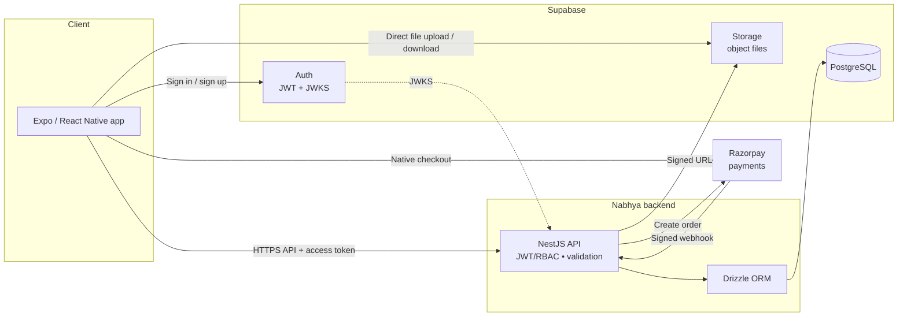
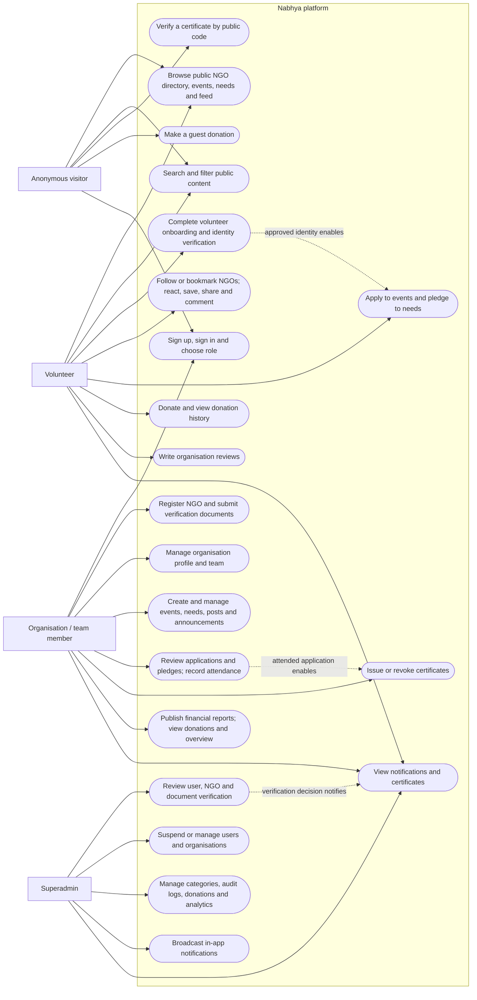
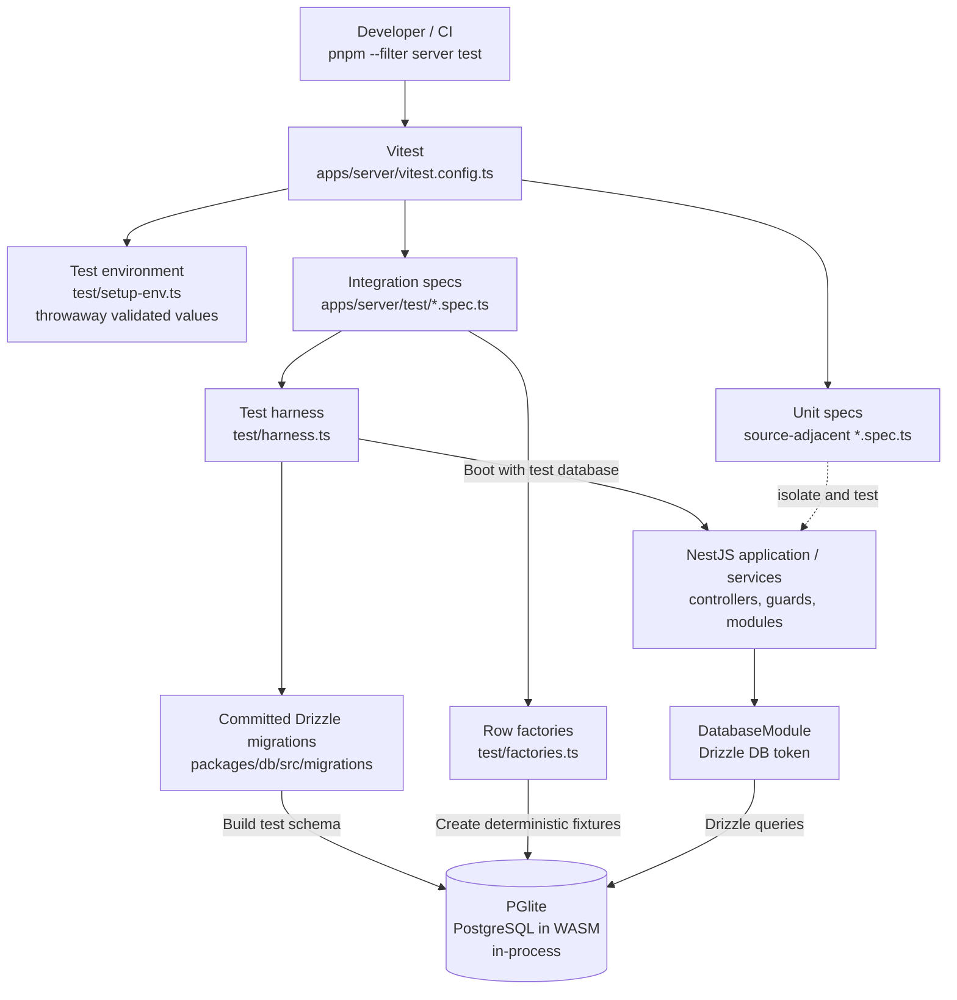
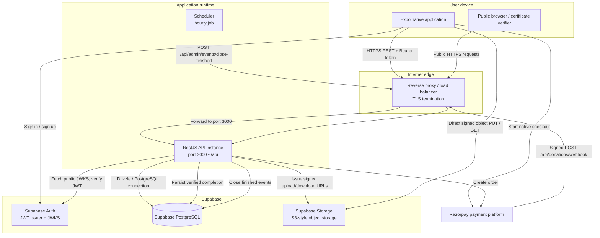

# Nabhya system diagrams

These diagrams describe the implementation in this repository as of October 2026.

> **Provider note:** the running system uses **Supabase Auth JWKS**, **Supabase PostgreSQL**, and **Supabase Storage**. It does **not** currently use Neon Auth or AWS S3. Supabase Storage fills the object-storage/S3 role in the architecture. `Razorpay` is the implemented payment provider and sends the payment webhook.
>
> The current Drizzle schema declares **29 tables**, rather than 22. The ER diagram therefore includes all 29 implemented tables.

## System architecture



**Key:** solid arrows are requests or data transfers; the dashed JWKS arrow is the API retrieving signing keys to validate access tokens.

### Architecture flow notes

- The Expo app authenticates with Supabase Auth; NestJS verifies access tokens with the remote JWKS and JIT-syncs the user into `users`.
- Files are uploaded directly from the Expo app to Supabase Storage using API-issued signed URLs. Database tables retain storage **object keys**, not public URLs.
- The API computes donation amounts and creates a pending donation. The client-side Razorpay success callback does not complete it; only a valid Razorpay webhook may do so.
- In development without Supabase Storage credentials, the server can use an in-memory storage stub. That is not durable and is refused in production.

## Entity relationship diagram

**Legend:** `PK` = primary key; `FK` = database foreign key; `UK` = unique key. Attributes are intentionally limited to identifiers and relationship-bearing fields so the 29-table diagram remains readable.

```mermaid
erDiagram
    users {
        uuid id PK
        varchar auth_user_id UK
        varchar email UK
        verification_status verification_status
        user_status status
    }
    roles {
        uuid id PK
        varchar name UK
    }
    user_roles {
        uuid id PK
        uuid user_id FK
        uuid role_id FK
    }
    user_documents {
        uuid id PK
        uuid user_id FK
        uuid verified_by FK
        text document_key
    }

    organizations {
        uuid id PK
        uuid owner_user_id FK UK
        uuid reviewed_by FK
        varchar organization_name
        org_verification_status verification_status
    }
    organization_admins {
        uuid id PK
        uuid organization_id FK
        uuid user_id FK
        uuid invited_by FK
        team_role role
        team_status status
    }
    team_invites {
        uuid id PK
        uuid organization_id FK
        uuid invited_by FK
        uuid accepted_by FK
        text token_hash UK
    }
    organization_ownership_transfers {
        uuid id PK
        uuid organization_id FK
        uuid from_member_id FK
        uuid to_member_id FK
        uuid requested_by FK
        uuid confirmed_by FK
        text token_hash UK
    }
    organization_documents {
        uuid id PK
        uuid organization_id FK
        uuid verified_by FK
        text document_key
    }

    categories {
        uuid id PK
        varchar slug UK
        varchar name
    }
    organization_categories {
        uuid id PK
        uuid organization_id FK
        uuid category_id FK
    }
    user_categories {
        uuid id PK
        uuid user_id FK
        uuid category_id FK
    }

    events {
        uuid id PK
        uuid organization_id FK
        uuid created_by FK
        event_status status
        timestamp start_at
    }
    event_applications {
        uuid id PK
        uuid event_id FK
        uuid volunteer_id FK
        uuid reviewed_by FK
        application_status status
        timestamp attended_at
    }
    needs {
        uuid id PK
        uuid organization_id FK
        uuid created_by FK
        need_type type
        need_status status
    }
    need_pledges {
        uuid id PK
        uuid need_id FK
        uuid user_id FK
        uuid reviewed_by FK
        pledge_status status
    }
    certificates {
        uuid id PK
        uuid application_id FK UK
        uuid event_id FK
        uuid volunteer_id FK
        uuid organization_id FK
        uuid issued_by FK
        varchar code UK
    }
    donations {
        uuid id PK
        uuid organization_id FK
        uuid donor_user_id FK
        varchar provider_payment_id UK
        donation_status status
    }

    bookmarks {
        uuid id PK
        uuid user_id FK
        uuid organization_id FK
    }
    follows {
        uuid id PK
        uuid user_id FK
        uuid organization_id FK
    }
    reviews {
        uuid id PK
        uuid user_id FK
        uuid organization_id FK
        integer rating
    }
    notifications {
        uuid id PK
        uuid user_id FK
        notification_type type
    }

    posts {
        uuid id PK
        uuid author_user_id FK
        uuid organization_id FK
        feed_item_type type
        varchar media_folder UK
    }
    posts_media {
        uuid id PK
        uuid post_id FK
        text object_key UK
    }
    post_interactions {
        uuid id PK
        uuid user_id FK
        uuid post_id
        feed_item_type target_type
        post_interaction_type interaction_type
    }
    post_comments {
        uuid id PK
        uuid user_id FK
        uuid post_id
        feed_item_type target_type
    }

    announcements {
        uuid id PK
        uuid organization_id FK
        uuid created_by FK
        announcement_status status
    }
    financial_reports {
        uuid id PK
        uuid organization_id FK
        uuid uploaded_by FK
        text document_key
    }
    audit_logs {
        uuid id PK
        uuid performed_by FK
        varchar action
        uuid entity_id
    }

    users ||--o{ user_roles : has
    roles ||--o{ user_roles : grants
    users ||--o{ user_documents : uploads
    users o|--o{ user_documents : verifies

    users ||--o| organizations : owns
    users o|--o{ organizations : reviews
    organizations ||--o{ organization_admins : has
    users ||--o{ organization_admins : joins
    users o|--o{ organization_admins : invites
    organizations ||--o{ team_invites : issues
    users o|--o{ team_invites : sends
    users o|--o{ team_invites : accepts
    organizations ||--o{ organization_ownership_transfers : has
    organization_admins ||--o{ organization_ownership_transfers : from_member
    organization_admins ||--o{ organization_ownership_transfers : to_member
    users o|--o{ organization_ownership_transfers : requests_or_confirms
    organizations ||--o{ organization_documents : owns
    users o|--o{ organization_documents : verifies

    organizations ||--o{ organization_categories : classified_by
    categories ||--o{ organization_categories : classifies
    users ||--o{ user_categories : interested_in
    categories ||--o{ user_categories : interest

    organizations ||--o{ events : publishes
    users o|--o{ events : creates
    events ||--o{ event_applications : receives
    users ||--o{ event_applications : applies
    users o|--o{ event_applications : reviews
    organizations ||--o{ needs : publishes
    users o|--o{ needs : creates
    needs ||--o{ need_pledges : receives
    users ||--o{ need_pledges : makes
    users o|--o{ need_pledges : reviews
    event_applications ||--o| certificates : earns
    events ||--o{ certificates : belongs_to
    users ||--o{ certificates : awarded_to
    organizations ||--o{ certificates : issues
    users o|--o{ certificates : issues_as
    organizations ||--o{ donations : receives
    users o|--o{ donations : makes

    users ||--o{ bookmarks : bookmarks
    organizations ||--o{ bookmarks : is_bookmarked
    users ||--o{ follows : follows
    organizations ||--o{ follows : is_followed
    users ||--o{ reviews : writes
    organizations ||--o{ reviews : receives
    users ||--o{ notifications : receives

    users ||--o{ posts : authors
    organizations o|--o{ posts : publishes
    posts ||--o{ posts_media : contains
    users ||--o{ post_interactions : performs
    users ||--o{ post_comments : writes
    organizations ||--o{ announcements : publishes
    users o|--o{ announcements : creates
    organizations ||--o{ financial_reports : publishes
    users o|--o{ financial_reports : uploads
    users o|--o{ audit_logs : performs
```

### ERD relationship constraints

- `user_roles`, `organization_categories`, and `user_categories` are many-to-many join tables. Their composite unique indexes prevent duplicate assignments.
- `event_applications` is unique on `(event_id, volunteer_id)`; `need_pledges` is unique on `(need_id, user_id)`; both enforce one active logical response per volunteer.
- `certificates.application_id` is unique, so an event application can have at most one certificate.
- `organization_admins` models team membership. Its partial unique indexes enforce one active owner per organization and one active owner organization per user.
- `post_interactions.post_id` and `post_comments.post_id` are **polymorphic references**, not foreign keys: `target_type` selects `posts`, `events`, `needs`, or `announcements`. The API verifies target existence and visibility.
- `audit_logs.entity_id` and `notifications.entity_id` are also polymorphic application references, so they are intentionally not database foreign keys.

## Use-case diagram



## Chapter 5 — Testing architecture diagram



### Testing characteristics

- Integration tests use the real NestJS modules and a real PostgreSQL-compatible engine (`PGlite`), not a mocked database.
- `test/harness.ts` constructs the test database from the committed Drizzle migrations. This makes schema/migration drift fail tests.
- `test/factories.ts` creates valid rows and relationship graphs for endpoint scenarios.
- `test/setup-env.ts` supplies throwaway environment values before imports that validate server configuration.
- `verify:di` is a complementary server check: it resolves controllers and services to catch missing explicit NestJS `@Inject(...)` dependencies.

## Chapter 6 — Deployment diagram



### Deployment notes

- The proxy/load balancer should use `GET /api/health` as its readiness probe because it verifies database connectivity. `GET /api` is liveness only.
- `trust proxy` is enabled only in production, where the API expects a proxy in front of it.
- Supabase Storage is the deployed object-store provider; it provides the role often labelled “S3” in a deployment diagram. The API never proxies file bytes.
- The scheduler must invoke `POST /api/admin/events/close-finished` (hourly is sufficient). It is the process that changes completed events out of `PUBLISHED`.
- The Razorpay webhook must retain the exact raw request body so its signature can be verified before any donation is marked `COMPLETED`.
