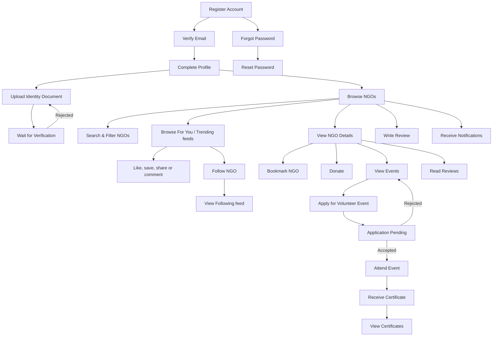

# Volunteer flow

The path a volunteer takes from signup to collecting a certificate. Mirrors the
"volunteer" role described in `AGENTS.md` → Roles.

Identity review controls the volunteer's verification status and badge; it is
not a prerequisite to browse NGOs, use the public feed, or apply to events.
Volunteers can continue those flows while review is pending.
