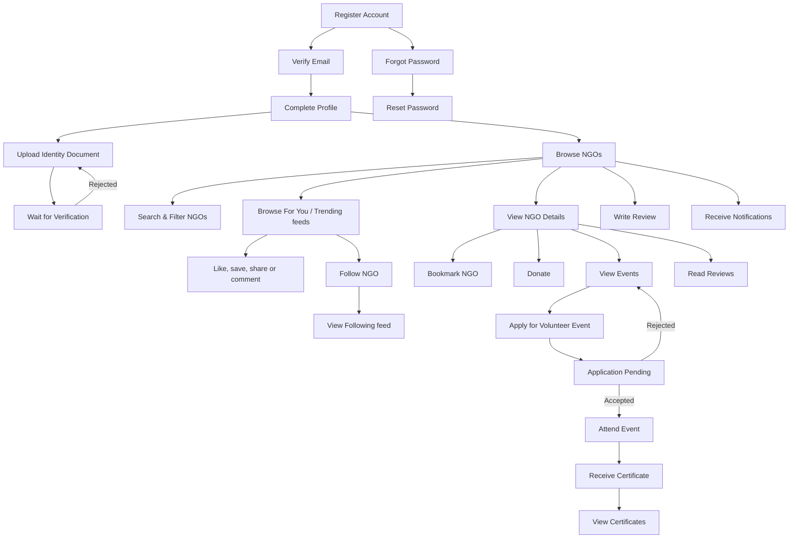

# Volunteer flow

The path a volunteer takes from signup to collecting a certificate. Mirrors the
"volunteer" role described in `AGENTS.md` → Roles.

Identity review controls the volunteer's verification status and badge, and it
gates the two in-person acts: **applying to an event and pledging to a need
both require a verified identity** (government ID and selfie, both approved).
Browsing NGOs, the public feed, following, reviewing and donating stay open
while review is pending; the apply and pledge sheets say what is missing and
link to verification.
