# Nabhya — NGO Connect Platform

## Final Year Project Report

| | |
|---|---|
| **Project** | Nabhya — a verified NGO ↔ volunteer platform for India |
| **Repository** | `SinghAman21/nabhya` (branch `post-review-1`) |
| **Platform** | Mobile app (Expo / React Native) + REST API (NestJS) + PostgreSQL (Supabase) |
| **Report date** | July 2026 |

---

## Table of Contents

1. [Abstract](#1-abstract)
2. [Introduction](#2-introduction)
3. [Problem Statement & Objectives](#3-problem-statement--objectives)
4. [System Overview & Actors](#4-system-overview--actors)
5. [Technology Stack](#5-technology-stack)
6. [System Architecture](#6-system-architecture)
7. [Database Design](#7-database-design)
8. [API Design](#8-api-design)
9. [UML & Behavioural Diagrams](#9-uml--behavioural-diagrams)
10. [Client Application Design](#10-client-application-design)
11. [Security Design](#11-security-design)
12. [Testing Strategy](#12-testing-strategy)
13. [Deployment & Operations](#13-deployment--operations)
14. [Limitations & Future Work](#14-limitations--future-work)
15. [Conclusion](#15-conclusion)
16. [Feed-ranking implementation addendum](#feed-ranking-implementation-addendum-september-2026)

---

## Feed-ranking implementation addendum (September 2026)

> This addendum supersedes the feed-related counts and descriptions in the July 2026
> snapshot below. The historical narrative remains useful for the original project scope.

Nabhya now exposes a **unified server-side recommendation feed** that combines generic
feed posts, published events, open needs/offers, and published announcements. It has three
separate views:

- **For You** — deterministic ranking over location, cause-category affinity, follows,
  recency, urgency and meaningful engagement. It uses Haversine distance when optional
  viewer coordinates exist, otherwise city/state matching; recent impressions down-rank
  rather than permanently hide candidates.
- **Trending** — public, time-decayed ranking using likes, saves, shares, comments, event
  applications and need pledges. An optional authenticated viewer adds location context.
- **Following** — reverse-chronological content from explicitly followed verified NGOs;
  it intentionally does not apply seen-content suppression.

The ranking implementation follows a candidate-pipeline approach: fetch each content source,
apply public-visibility/expiry/status filters, hydrate category, follow and engagement signals,
score candidates, then select a diverse result. Selection avoids more than two consecutive
items from one organisation and avoids extended runs of a single item type.

The database now has **25 tables** and the API has **104 endpoints**. New persistence includes
`organization_follows`, polymorphic `feed_interactions` (`LIKE`, `SAVE`, `SHARE`,
`IMPRESSION`) and `feed_comments`; generic feed posts can belong to an NGO and carry location.
Interactions target `POST`, `EVENT`, `NEED` or `ANNOUNCEMENT`, and the service validates each
target is still publicly visible before accepting an action. Migration
`0007_feed_ranking.sql` records these changes.

The routes are `GET /api/feed/for-you`, `GET /api/feed/trending`, and
`GET /api/feed/following`, with follow and interaction routes documented in the current README
and Swagger. They are presently **server-only**: native feed tabs and interaction controls are
future client work.

---

## 1. Abstract

Nabhya is a mobile-first platform that connects **verified NGOs** with **volunteers and donors** across India. NGOs register, upload their legal documents (registration certificate, PAN, 80G/12A certificates, etc.), and are manually verified by a platform superadmin before anything they publish becomes publicly visible. Once verified, an NGO can publish **volunteering events** and **"needs"** — items it wants donated (*WANT*, e.g. "200 blankets") or surplus items it is offering to give away (*OFFER*, e.g. "40 school desks"). Item-level giving is the platform's core differentiator over event-only volunteering apps.

Volunteers browse a public feed of events and needs, apply to events, pledge items against needs, bookmark and review organisations, donate money, and collect **publicly verifiable participation certificates** whose codes anyone can validate without an account.

The system is built as a TypeScript monorepo: an **Expo (React Native) client**, a **NestJS 11 REST API** (91 endpoints across 14 feature modules), and a **PostgreSQL database on Supabase** accessed through Drizzle ORM (22 tables). Authentication is delegated to **Supabase Auth** with stateless JWT verification against a remote JWKS. Files are stored in **Cloudflare R2** object storage using a pre-signed-URL flow so bytes never pass through the API. The server ships with a Vitest integration suite that runs against a real in-process Postgres (PGlite) built from the committed migrations.

---

## 2. Introduction

India has one of the largest NGO ecosystems in the world, but discovery and trust remain the two hardest problems for a citizen who wants to help: *Which organisations near me are genuine? What do they actually need right now?* Most existing platforms either list unverified organisations, or reduce "helping" to monetary donations only.

Nabhya addresses both problems:

- **Trust** — every organisation passes a document-based verification workflow reviewed by a superadmin before it can publish anything. Volunteers can additionally verify their identity (Aadhaar-based document upload). Public listings are server-side filtered so an unverified or suspended NGO can never surface.
- **Actionable giving** — beyond volunteering at events, the platform models *item-level* giving in both directions: NGOs post what they need, and also what surplus they can give away. A blanket drive and a school-desk giveaway are both first-class objects with quantity tracking.
- **Recognition** — attendance-gated volunteering certificates with public verification codes make a volunteer's contribution provable to a third party (e.g. a college or employer).

### Scope of this report

This report documents the system as implemented on the `post-review-1` branch: the architecture, the complete database schema, the API surface, the main behavioural flows as UML-level diagrams, the security model, and the testing and deployment posture.

---

## 3. Problem Statement & Objectives

### 3.1 Problem statement

> Design and implement a trustworthy, mobile-first platform where verified NGOs can publish volunteering opportunities and material needs, and where citizens can discover nearby organisations, contribute time / items / money, and receive verifiable recognition — with an administrative layer that performs verification, moderation, and auditing.

### 3.2 Objectives

1. **Verified onboarding** for two user roles (volunteer, organisation) with a superadmin document-verification queue for both NGO legal documents and volunteer identity documents.
2. **Event lifecycle management** — draft → publish → applications → accept/reject → attendance → completion — with capacity accounting that is safe under concurrency.
3. **Item-donation ("needs") lifecycle** — WANT/OFFER posts with quantity/urgency, pledges from users, and transactional fulfilment accounting.
4. **Public discovery** — an anonymous-accessible feed of events, needs and an NGO directory with proximity ("near me") search, that can only ever show verified + active organisations.
5. **Engagement layer** — bookmarks, reviews with organisation replies, announcements, public financial-transparency reports, in-app notifications and superadmin broadcast.
6. **Certificates** — attendance-gated issuance, PDF generation, revocation, and account-less public verification by code.
7. **Monetary donations** via Razorpay's native checkout SDK with webhook-driven settlement that never trusts the client's checkout-success callback.
8. **Operational integrity** — audit trail of every administrative and sensitive action, rate limiting, and a test suite that exercises real SQL semantics (unique indexes, row locks, aggregates).

---

## 4. System Overview & Actors

Three roles are defined in the database seed (`packages/db/src/seed.ts`) and used by the API's role guard. A user has no role at signup; the role-select screen is the only thing that grants one.

| Actor | Capabilities |
|---|---|
| **Volunteer** | Verify identity, browse/bookmark NGOs, apply to events, withdraw applications, pledge items against needs, review NGOs, donate money, view impact summary, collect and download certificates |
| **Organisation (NGO)** | Register and upload legal documents, manage profile and team, create/publish events and needs, accept/reject applicants and pledges, mark attendance, issue/revoke certificates, post announcements and financial reports, reply to reviews, view donations received |
| **Superadmin** | Approve/reject/suspend organisations and users, verify both document types (org + identity), platform overview dashboard, audit-log search, broadcast notifications, close finished events |
| **Anonymous visitor** | Browse the public feed (events, needs, NGO directory, reviews, announcements, reports, impact figures), verify a certificate by code, make a guest donation |

### High-level use-case map

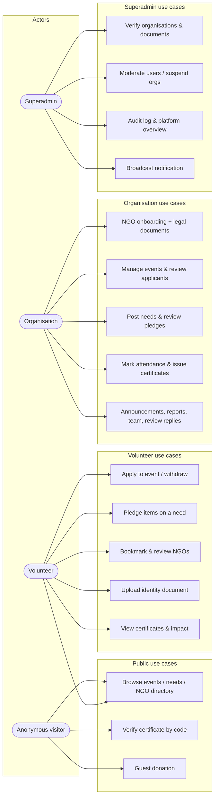

---

## 5. Technology Stack

### 5.1 Monorepo

pnpm workspaces + **Turborepo**; Node ≥ 22, `pnpm@10.10.0`; **Biome** for lint/format; Husky + lint-staged pre-commit hooks.

```
apps/native        Expo SDK 56 + Expo Router — the mobile client
apps/server        NestJS 11 REST API, global prefix /api, port 3000
packages/db        Drizzle ORM schema + pg client        (@nabhya/db)
packages/env       t3-oss/env runtime env validation      (@nabhya/env)
packages/shared    Zod schemas shared client ↔ server     (@nabhya/shared)
packages/config    Shared biome / tsconfig presets        (@nabhya/config)
scripts/           Interactive Supabase setup wizard (pnpm db:setup)
```

### 5.2 Key technologies and versions

| Layer | Technology | Version | Purpose |
|---|---|---|---|
| Mobile client | Expo / Expo Router | SDK 56 / router 56.2 | File-based routing, typed routes, React Compiler enabled |
| | React / React Native | 19.2.3 / 0.85.3 | UI runtime |
| | Zustand | 5.x | Persisted auth/session state |
| | TanStack Query | 5.x | Server-state cache, mutations, invalidation |
| | react-hook-form + zodResolver | 7.x | Forms validated by the *shared* Zod schemas |
| | NativeWind + Tailwind | 4.x / 3.4 | Styling (alongside a design-token system) |
| | axios | 1.x | HTTP client with auth interceptor |
| API | NestJS | 11.x | Modular DI framework, controllers/guards/pipes |
| | @nestjs/swagger | 11.x | OpenAPI docs at `/api/docs` |
| | @nestjs/throttler | 6.x | Rate limiting (two buckets) |
| | jose | 5.x | JWT verification against remote JWKS |
| | pdf-lib | 1.17 | Certificate PDF rendering |
| | AWS SDK v3 (S3 + presigner) | 3.x | Cloudflare R2 object storage (S3-compatible) |
| Data | PostgreSQL (Supabase) | — | Primary datastore |
| | Drizzle ORM / drizzle-kit | 0.45 | Typed schema, queries, migrations |
| Auth | Supabase Auth | — | Hosted identity provider issuing JWTs |
| Validation | Zod | 4.x (catalog) | Single source of truth for all request/response shapes |
| Testing | Vitest + PGlite | 4.x / 0.5 | Integration tests on real in-process Postgres |
| Tooling | Biome, Turborepo, tsdown/tsx | — | Lint/format, task graph, esbuild-based build/dev |

### 5.3 Contract-first validation

A deliberate architectural decision: **every request/response shape is a Zod schema in `@nabhya/shared`**. The server validates request bodies with a `ZodValidationPipe(schema)`; the client imports the *same* schema into `react-hook-form` via `zodResolver`. There is no hand-written duplicate DTO layer, so client and server cannot drift.

---

## 6. System Architecture

### 6.1 Component architecture

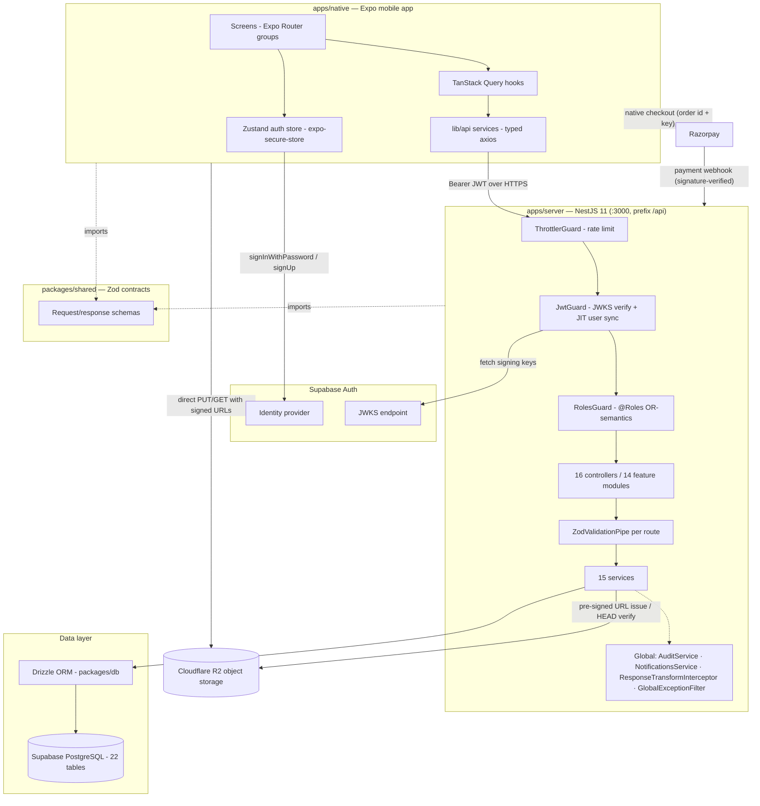

Key properties:

- **Everything is protected by default.** The JWT guard is global; public access is an explicit opt-out per route (`@Public()` / `@OptionalAuth()`).
- **File bytes never pass through the API.** The client PUTs directly to R2 with a pre-signed URL and only the resulting *object key* is stored (see §9.4).
- **Cross-cutting concerns are global Nest modules** — database handle, storage provider, audit trail, and notifications are `@Global()` providers injectable anywhere.
- **The response envelope is uniform**: every success is `{ success: true, data, timestamp }` (interceptor), every error is `{ statusCode, timestamp, path, message, errors? }` (exception filter), and every list endpoint returns a `Paginated<T>` envelope.

### 6.2 Server module dependency graph

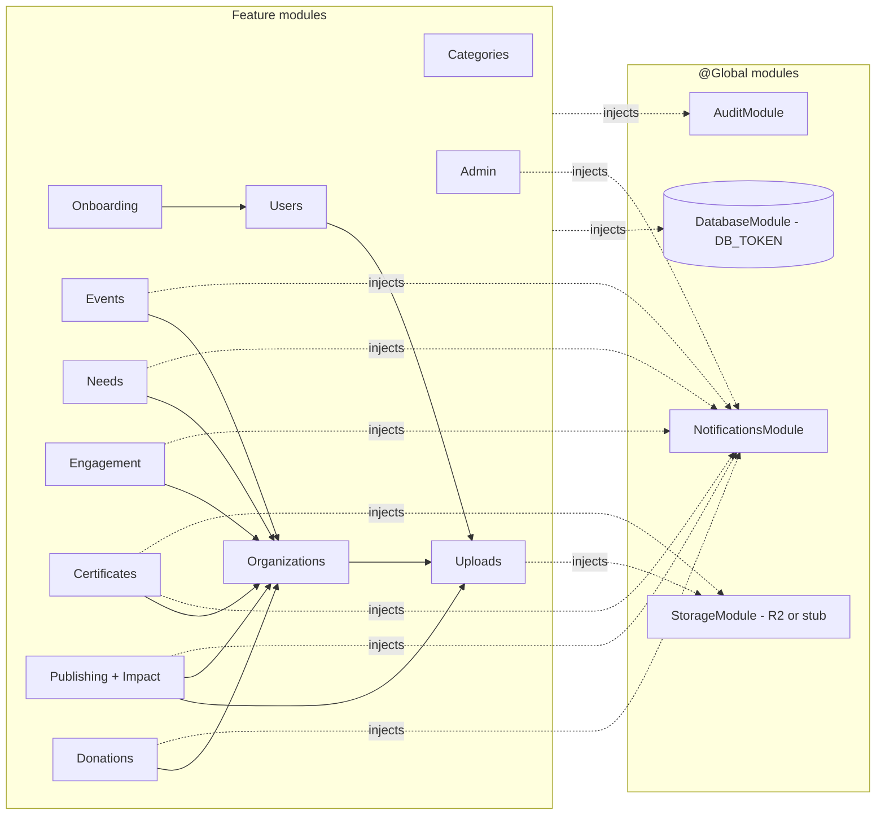

`OrganizationsService` is the linchpin: it exposes `requireOwnedOrganization(userId)` and `requireVerifiedOrganization(userId)`, which every organisation-scoped module uses to resolve the caller's NGO **from the token** — an organisation id is never accepted from the client, and anything that becomes publicly visible additionally requires the NGO to be verified.

### 6.3 Request lifecycle

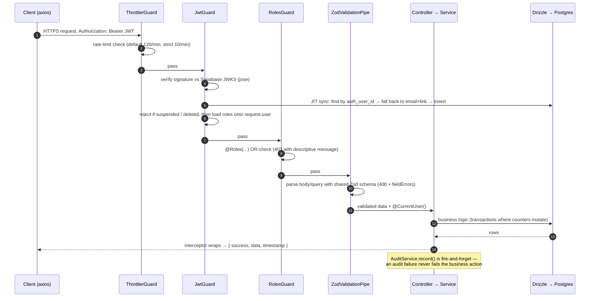

---

## 7. Database Design

Drizzle ORM on Supabase PostgreSQL. **22 tables** across 10 schema files in `packages/db/src/schema/`, UUID primary keys throughout, generated SQL migrations committed in `packages/db/src/migrations/`. Seed data (`db:seed`) creates the three roles and ten cause categories.

### 7.1 Entity–Relationship diagram

```mermaid
erDiagram
    USERS ||--o{ USER_ROLES : "has"
    ROLES ||--o{ USER_ROLES : "granted via"
    USERS ||--o{ USER_DOCUMENTS : "uploads"
    USERS ||--o| ORGANIZATIONS : "owns (unique)"
    ORGANIZATIONS ||--o{ ORGANIZATION_ADMINS : "team"
    USERS ||--o{ ORGANIZATION_ADMINS : "member of"
    ORGANIZATIONS ||--o{ ORGANIZATION_DOCUMENTS : "legal docs"
    ORGANIZATIONS ||--o{ ORGANIZATION_CATEGORIES : "tagged"
    CATEGORIES ||--o{ ORGANIZATION_CATEGORIES : ""
    USERS ||--o{ USER_CATEGORIES : "interests"
    CATEGORIES ||--o{ USER_CATEGORIES : ""
    ORGANIZATIONS ||--o{ EVENTS : "hosts"
    EVENTS ||--o{ EVENT_APPLICATIONS : "receives"
    USERS ||--o{ EVENT_APPLICATIONS : "applies"
    ORGANIZATIONS ||--o{ ORGANIZATION_NEEDS : "posts"
    ORGANIZATION_NEEDS ||--o{ NEED_PLEDGES : "receives"
    USERS ||--o{ NEED_PLEDGES : "pledges"
    EVENT_APPLICATIONS ||--o| CERTIFICATES : "earns (unique)"
    ORGANIZATIONS ||--o{ CERTIFICATES : "issues"
    USERS ||--o{ CERTIFICATES : "holds"
    ORGANIZATIONS ||--o{ DONATIONS : "receives"
    USERS |o--o{ DONATIONS : "donates (nullable for guests)"
    USERS ||--o{ BOOKMARKS : "saves"
    ORGANIZATIONS ||--o{ BOOKMARKS : "saved by"
    USERS ||--o{ ORGANIZATION_FOLLOWS : "follows"
    ORGANIZATIONS ||--o{ ORGANIZATION_FOLLOWS : "followed by"
    USERS ||--o{ FEED_INTERACTIONS : "records"
    USERS ||--o{ FEED_COMMENTS : "writes"
    ORGANIZATIONS ||--o{ REVIEWS : "reviewed"
    USERS ||--o{ REVIEWS : "writes"
    USERS ||--o{ NOTIFICATIONS : "receives"
    ORGANIZATIONS ||--o{ ANNOUNCEMENTS : "publishes"
    ORGANIZATIONS ||--o{ FINANCIAL_REPORTS : "publishes"
    USERS |o--o{ AUDIT_LOGS : "performed by"

    USERS {
        uuid id PK
        varchar auth_user_id UK "link to Supabase Auth subject"
        varchar email UK
        varchar full_name
        varchar phone
        text bio
        varchar city
        varchar state
        enum verification_status "PENDING/VERIFIED/REJECTED"
        enum status "ACTIVE/SUSPENDED/DELETED"
        text suspended_reason
        timestamp onboarded_at
    }
    ORGANIZATIONS {
        uuid id PK
        uuid owner_user_id FK,UK "one org per owner"
        varchar organization_name
        enum org_type "TRUST/SOCIETY/SECTION_8/OTHERS"
        varchar registration_number
        text mission
        text vision
        varchar city
        decimal latitude "haversine proximity search"
        decimal longitude
        integer team_size
        integer founding_year
        enum verification_status "PENDING/UNDER_REVIEW/VERIFIED/REJECTED"
        text rejection_reason
        uuid reviewed_by FK
        enum status "ACTIVE/SUSPENDED"
    }
    EVENTS {
        uuid id PK
        uuid organization_id FK
        varchar title
        varchar venue
        decimal latitude
        timestamp start_at
        timestamp end_at
        timestamp application_deadline
        integer volunteers_needed
        integer accepted_count "denormalised, lock-guarded"
        enum status "DRAFT/PUBLISHED/CANCELLED/COMPLETED"
        uuid created_by FK
    }
    EVENT_APPLICATIONS {
        uuid id PK
        uuid event_id FK "unique with volunteer_id"
        uuid volunteer_id FK
        enum status "PENDING/ACCEPTED/REJECTED/WITHDRAWN"
        text message
        uuid reviewed_by FK
        timestamp attended_at "gates certificate issuance"
    }
    ORGANIZATION_NEEDS {
        uuid id PK
        uuid organization_id FK
        enum type "WANT/OFFER"
        varchar title
        integer quantity "nullable — open-ended needs"
        varchar unit
        integer fulfilled_quantity "denormalised, lock-guarded"
        enum urgency "LOW/MEDIUM/HIGH"
        enum status "OPEN/FULFILLED/CLOSED"
        timestamp expires_at
    }
    NEED_PLEDGES {
        uuid id PK
        uuid need_id FK
        uuid user_id FK
        integer quantity
        enum status "PENDING/ACCEPTED/REJECTED/COMPLETED/CANCELLED"
        uuid reviewed_by FK
    }
    CERTIFICATES {
        uuid id PK
        uuid application_id FK,UK "one per participation"
        uuid event_id FK
        uuid volunteer_id FK
        uuid organization_id FK
        varchar code UK "public verification handle"
        text pdf_key "object-storage key"
        uuid issued_by FK
        timestamp revoked_at
    }
    DONATIONS {
        uuid id PK
        uuid organization_id FK
        uuid donor_user_id FK "nullable — guest donations"
        integer amount_minor "paise, never floats"
        varchar currency
        enum status "PENDING/COMPLETED/FAILED/REFUNDED"
        varchar provider_payment_id UK "webhook replay guard"
        varchar receipt_number UK
        boolean is_anonymous
    }
    AUDIT_LOGS {
        uuid id PK
        uuid performed_by FK "null-safe on user delete"
        varchar action
        varchar entity_name
        uuid entity_id
        jsonb old_value
        jsonb new_value
        varchar ip_address
    }
```

*(Join/support tables — `roles`, `user_roles`, `user_documents`, `organization_admins`, `organization_documents`, `categories`, `organization_categories`, `user_categories`, `bookmarks`, `organization_follows`, `feed_interactions`, `feed_comments`, `reviews`, `notifications`, `announcements`, `financial_reports` — are shown as relationships above and detailed in the data dictionary below.)*

### 7.2 Data dictionary

#### Identity & access (`users.ts`)

| Table | Columns (key ones) | Constraints & indexes |
|---|---|---|
| `users` | `id`, `neon_user_id`, `full_name`, `email`, `phone`, `profile_image`, `bio`, `city`, `state`, optional `latitude`/`longitude`, `email_verified`, `verification_status`, `status`, `suspended_reason`, `onboarded_at`, timestamps | `neon_user_id` unique, `email` unique. Optional coordinates enable distance ranking; `onboarded_at` gates volunteer entry into the app (orgs are gated by the existence of their organisation row) |
| `roles` | `id`, `name`, `description` | `name` unique. Seeded: `volunteer`, `organisation`, `superadmin` |
| `user_roles` | `id`, `user_id`, `role_id`, `assigned_at` | FKs cascade on delete |
| `user_documents` | `id`, `user_id`, `document_type` (AADHAR_CARD/OTHER), `document_key`, `verification_status`, `remarks`, `verified_by`, `verified_at` | `verified_by` → users (reviewer). Stores object-storage **keys**, not URLs |

#### Organisations (`organizations.ts`)

| Table | Columns (key ones) | Constraints & indexes |
|---|---|---|
| `organizations` | owner, name, `org_type`, `registration_number`, contact fields, `description`/`mission`/`vision`, `logo`, `cover_image`, address + `latitude`/`longitude`, `team_size`, `founding_year`, `verification_status`, `rejection_reason`, `reviewed_by/at`, `status` | **Unique index on `owner_user_id`** (a double-submitted onboarding form cannot create a duplicate NGO); indexes on `verification_status` (admin queue), `city`, `latitude` (bounding-box prefilter for haversine proximity search) |
| `organization_admins` | org, user, `designation`, `is_owner`, `joined_at` | Team membership; cascades with org/user |
| `organization_documents` | org, `document_type` (NGO_REGISTRATION_CERTIFICATE, PAN_CARD, 80G, 12A, GST, BANK_ACCOUNT_PROOF, OTHER), `document_key`, `verification_status`, `remarks`, `verified_by/at` | Private verification artefacts reviewed by superadmin |

#### Categories (`categories.ts`)

| Table | Purpose |
|---|---|
| `categories` | 10 seeded cause categories (`slug` unique, lucide `icon` name, `is_active`) |
| `organization_categories` | M:N org ↔ category, unique per pair |
| `user_categories` | M:N volunteer interest ↔ category, unique per pair |

#### Generic feed posts (`feed.ts`)

| Table | Columns (key ones) | Constraints & indexes |
|---|---|---|
| `feed_posts` | author, optional organisation, optional city/state/coordinates, text, media folder, created timestamp | Organization/time and city indexes support unified retrieval. NGO-authored posts inherit the owner's organization and location. |
| `feed_post_media` | post, object key, image/video type, MIME type, sort order | Object keys are unique; `(post, sort_order)` preserves the submitted media sequence. |

#### Events (`events.ts`)

| Table | Columns (key ones) | Constraints & indexes |
|---|---|---|
| `events` | org, `title`, `description`, `cover_image`, venue/address/city/state + coordinates, `start_at`, `end_at`, `application_deadline`, `volunteers_needed`, **`accepted_count`** (denormalised), `status`, `created_by` | Indexes: `(status, start_at)` drives the public feed; `organization_id`; `city`. `accepted_count` is only ever mutated inside the application-review transaction |
| `event_applications` | event, volunteer, `status`, `message`, `review_note`, `reviewed_by/at`, **`attended_at`**, `applied_at` | **Unique `(event_id, volunteer_id)`** — the DB, not application code, is the source of truth for one-application-per-volunteer. `attended_at` gates certificate issuance |

#### Needs / item donations (`needs.ts`) — the core differentiator

| Table | Columns (key ones) | Constraints & indexes |
|---|---|---|
| `organization_needs` | org, **`type` (WANT / OFFER)**, `title`, `description`, `quantity` (nullable — "as many as possible" is legitimate), `unit`, **`fulfilled_quantity`** (denormalised), `urgency`, `status`, city/state, `expires_at` | Indexes: `(status, type)` drives the public needs feed; org; city |
| `need_pledges` | need, user, `quantity`, `message`, `status`, `review_note`, `reviewed_by/at` | On a WANT: "I will supply N"; on an OFFER: "I would like to receive N". Indexes on `(need_id, status)` and user |

#### Certificates (`certificates.ts`)

| Table | Columns (key ones) | Constraints & indexes |
|---|---|---|
| `certificates` | `application_id`, `event_id`, `volunteer_id`, `organization_id`, **`code`** (unique, human-quotable, printed on the PDF), `pdf_key`, `note`, `issued_by/at`, `revoked_at`, `revoked_reason` | **Unique on `application_id`** — re-issuing replaces the PDF rather than minting a second code. A revoked code still resolves but reads as void |

#### Donations (`donations.ts`)

| Table | Columns (key ones) | Constraints & indexes |
|---|---|---|
| `donations` | org, `donor_user_id` (nullable → guest), **`amount_minor`** (integer paise — never floats), `currency`, `status`, `provider`, `provider_checkout_id`, **`provider_payment_id` (unique — webhook replay cannot double-count)**, `message`, `is_anonymous`, `receipt_number` (unique), donor name/email, `completed_at`, `failure_reason` | Created PENDING with a **server-computed amount**; only the provider webhook moves it to COMPLETED |

#### Engagement (`engagement.ts`)

| Table | Columns (key ones) | Constraints & indexes |
|---|---|---|
| `bookmarks` | user, org, `created_at` | Unique `(user, org)` makes the bookmark toggle idempotent under double-taps |
| `reviews` | org, user, `rating`, `body`, `reply` (org's public response), `replied_at` | Unique `(org, user)` — one review per person, editing updates in place |
| `organization_follows` | user, org, `created_at` | Unique `(user, org)`; separate from a private bookmark and drives the Following feed |
| `feed_interactions` | user, polymorphic `target_type` + `target_id`, `interaction_type`, `created_at` | Targets POST/EVENT/NEED/ANNOUNCEMENT. LIKE and SAVE are unique per user/target; SHARE and IMPRESSION are append-only analytics events |
| `feed_comments` | user, polymorphic `target_type` + `target_id`, `body`, timestamps | Indexed by target chronology and author; the service validates target visibility before writes |
| `notifications` | user, `type` (14-value enum: application/pledge outcomes, org/document verification, certificate, donation, review, broadcast), `title`, `body`, `entity_name` + `entity_id` (client deep-link), `read_at` | A broadcast fans out into one row per user, so read state and the unread badge stay a plain indexed query |

#### Publishing (`publishing.ts`)

| Table | Columns (key ones) | Notes |
|---|---|---|
| `announcements` | org, `title`, `body`, `cover_image_key`, `status` (DRAFT/PUBLISHED), `is_pinned`, `published_at`, `created_by` | Public org updates; publishing notifies everyone who bookmarked the org |
| `financial_reports` | org, `type` (ANNUAL_REPORT, AUDITED_STATEMENT, FCRA_RETURN, UTILISATION_CERTIFICATE, OTHER), `title`, `financial_year`, `document_key`, `notes` | **Public by design** — transparency documents a donor uses to decide trust; distinct from the private `organization_documents` |

#### Audit (`audit.ts`)

| Table | Columns | Notes |
|---|---|---|
| `audit_logs` | `performed_by` (SET NULL on user delete), `action`, `entity_name`, `entity_id`, `old_value`/`new_value` (jsonb), `ip_address`, `created_at` | Append-only; surfaced in the superadmin console with search |

### 7.3 Notable database design decisions

1. **Denormalised counters with pessimistic locking.** `events.accepted_count` and `organization_needs.fulfilled_quantity` exist so public listings avoid per-row aggregates. They are mutated *only* inside a transaction that first takes `SELECT … FOR UPDATE` on the parent row, so concurrent accepts cannot oversell capacity or overshoot fulfilment.
2. **Uniqueness enforced in the database, not the application.** One application per volunteer per event, one review per user per org, one org per owner, one certificate per participation, one donation per provider payment id — all unique indexes. Application-level checks are treated as UX, not correctness.
3. **Haversine instead of PostGIS.** "Near me" filters on an indexed latitude bounding box first, then computes haversine distance in SQL — one dependency fewer, accurate enough at city scale.
4. **Object-storage keys, not URLs.** Every file column (`document_key`, `pdf_key`, `cover_image_key`, …) stores a key like `org-documents/{orgId}/{uuid}-name`. The owning id is baked into the key, which is how download authorisation works without trusting the client.
5. **Money is integer minor units** (paise) — floats never touch monetary values.
6. **Dual-reference reviewer columns.** Applications, pledges and documents reference `users` twice (actor + reviewer). Drizzle cannot disambiguate reverse relations without `relationName`, so `users` deliberately does not expose reverse relations to these tables — they are queried from the child side.
7. **Migrations exist and are exercised by tests** (the Vitest suite builds its PGlite database from the committed migrations, so a drift between schema and migrations fails the suite), while local development still uses `drizzle-kit push` on boot (see §14).

---

## 8. API Design

**91 REST endpoints** across **16 controllers** in **14 feature modules**, all under the global `/api` prefix, documented via Swagger/OpenAPI at `/api/docs`. Guard order for every request: `ThrottlerGuard → JwtGuard → RolesGuard`. Authentication is the **default**; a route is public only via an explicit `@Public()` or `@OptionalAuth()` decorator.

### 8.1 Access-control legend

| Gate | Meaning |
|---|---|
| *(auth)* | Any authenticated user (valid JWT, account active) |
| `@Public` | No token required |
| `@OptionalAuth` | Anonymous allowed; a valid token additionally populates `request.user` so the response can include the caller's own application/pledge. An invalid token reads as anonymous |
| `@Roles(r)` | Requires the named role (OR semantics when several are listed) |

### 8.2 Endpoint inventory by module

#### Health

| Route | Gate | Purpose |
|---|---|---|
| `GET /api` | Public | Liveness probe (process up) |
| `GET /api/health` | Public | Readiness probe — queries the DB and reports storage mode |

#### Users & Onboarding

| Route | Gate | Purpose |
|---|---|---|
| `GET /api/users/me` | auth | Own profile |
| `PATCH /api/users/me` | auth | Update own profile |
| `POST /api/users/me/role` | auth | One-shot role selection |
| `GET /api/users/me/documents` | auth | List own identity documents |
| `POST /api/users/me/documents` | auth | Submit identity document for verification |
| `GET /api/onboarding/status` | auth | Where the caller is in the onboarding flow |
| `POST /api/onboarding/organization` | organisation | Submit the NGO onboarding wizard |
| `POST /api/onboarding/volunteer` | volunteer | Submit the volunteer onboarding profile |

#### Organizations & Categories

| Route | Gate | Purpose |
|---|---|---|
| `GET /api/organizations` | Public | Browse verified NGO directory |
| `GET /api/organizations/nearby` | Public | Verified NGOs near a coordinate (haversine) |
| `GET /api/organizations/:id` | Public | Public profile of a verified NGO |
| `GET /api/organizations/me` | organisation | Caller's owned organisation |
| `PATCH /api/organizations/me` | organisation | Update own org profile |
| `GET /api/organizations/me/documents` | organisation | List org verification documents |
| `POST /api/organizations/me/documents` | organisation | Submit a verification document |
| `GET /api/categories` | Public | List active cause categories |

#### Events (public + volunteer side)

| Route | Gate | Purpose |
|---|---|---|
| `GET /api/events` | Public | Published events from verified NGOs |
| `GET /api/events/:id` | OptionalAuth | Event detail (+ caller's own application if signed in) |
| `GET /api/events/me/applications` | volunteer | Own applications |
| `POST /api/events/:id/applications` | volunteer | Apply to an event |
| `DELETE /api/events/:id/applications/me` | volunteer | Withdraw own application |

#### Org Events (organisation side, `org/*` — org resolved from the token)

| Route | Gate | Purpose |
|---|---|---|
| `GET /api/org/events` | organisation | List own events |
| `POST /api/org/events` | organisation | Create event (verified org required) |
| `PATCH /api/org/events/:id` | organisation | Update event |
| `DELETE /api/org/events/:id` | organisation | Delete / cancel event |
| `GET /api/org/events/:id/applications` | organisation | List applicants |
| `PATCH /api/org/events/:id/applications/:applicationId` | organisation | Accept / reject applicant (locked counter update) |

#### Needs (public + volunteer side)

| Route | Gate | Purpose |
|---|---|---|
| `GET /api/needs` | Public | Open needs & offers feed |
| `GET /api/needs/:id` | OptionalAuth | Need detail (+ caller's own pledge) |
| `GET /api/needs/me/pledges` | volunteer | Own pledges |
| `POST /api/needs/:id/pledges` | volunteer | Pledge to fulfil a WANT / claim an OFFER |

#### Org Needs

| Route | Gate | Purpose |
|---|---|---|
| `GET /api/org/needs` | organisation | List own posts |
| `POST /api/org/needs` | organisation | Post a need/offer (verified org required) |
| `PATCH /api/org/needs/:id` | organisation | Update a post |
| `DELETE /api/org/needs/:id` | organisation | Delete / close a post |
| `GET /api/org/needs/:id/pledges` | organisation | List responses |
| `PATCH /api/org/needs/:id/pledges/:pledgeId` | organisation | Accept / reject / complete a pledge (locked counter update) |

#### Engagement (bookmarks, follows & reviews)

| Route | Gate | Purpose |
|---|---|---|
| `POST /api/organizations/:id/bookmark` | volunteer | Toggle bookmark |
| `GET /api/me/bookmarks` | volunteer | Own bookmarked NGOs |
| `POST /api/organizations/:id/follow` | authenticated | Follow a verified active NGO (idempotent) |
| `DELETE /api/organizations/:id/follow` | authenticated | Unfollow an NGO |
| `GET /api/organizations/:id/reviews` | Public | Reviews + rating summary |
| `POST /api/organizations/:id/reviews` | volunteer *(strict throttle)* | Leave or edit review |
| `DELETE /api/organizations/:id/reviews/me` | volunteer | Delete own review |
| `GET /api/org/reviews` | organisation | Reviews of caller's org |
| `PATCH /api/org/reviews/:reviewId/reply` | organisation | Public reply to a review |

#### Unified feed and interactions

| Route | Gate | Purpose |
|---|---|---|
| `GET /api/feed/for-you` | OptionalAuth | Unified personalized ranking; anonymous callers receive an unpersonalized fallback |
| `GET /api/feed/trending` | Public / OptionalAuth | Unified recent-engagement ranking |
| `GET /api/feed/following` | authenticated | Reverse-chronological content from followed NGOs |
| `POST` / `DELETE /api/feed/:type/:id/like` | authenticated | Like or unlike a unified feed item |
| `POST` / `DELETE /api/feed/:type/:id/save` | authenticated | Save or unsave a unified feed item |
| `POST /api/feed/:type/:id/share` | authenticated | Record a share event |
| `POST /api/feed/:type/:id/impression` | authenticated | Record an impression for For You novelty ranking |
| `GET` / `POST /api/feed/:type/:id/comments` | Public / authenticated | List or add comments |
| `DELETE /api/feed/comments/:commentId` | authenticated | Delete own comment; superadmin may moderate |

`type` is `POST`, `EVENT`, `NEED` or `ANNOUNCEMENT`; all actions validate public visibility.

#### Certificates & Attendance

| Route | Gate | Purpose |
|---|---|---|
| `PATCH /api/org/events/:eventId/applications/:applicationId/attendance` | organisation | Mark volunteer attendance |
| `POST /api/org/events/:eventId/applications/:applicationId/certificate` | organisation | Issue certificate (attendance-gated) |
| `PATCH /api/org/certificates/:id/revoke` | organisation | Revoke a certificate |
| `GET /api/me/certificates` | volunteer | Own certificates |
| `GET /api/me/certificates/:id/pdf` | volunteer | Signed PDF download link |
| `GET /api/certificates/:code/verify` | Public | **Account-less verification by code** |

#### Publishing (announcements, reports, team, impact)

| Route | Gate | Purpose |
|---|---|---|
| `GET /api/organizations/:id/announcements` | Public | Org's public updates |
| `GET /api/org/announcements` | organisation | Own updates incl. drafts |
| `POST /api/org/announcements` | organisation | Post update (notifies bookmarkers) |
| `PATCH /api/org/announcements/:id` | organisation | Edit update |
| `DELETE /api/org/announcements/:id` | organisation | Delete update |
| `GET /api/organizations/:id/reports` | Public | Published transparency documents |
| `POST /api/org/reports` | organisation | Publish a financial report |
| `DELETE /api/org/reports/:id` | organisation | Withdraw a report |
| `GET /api/org/team` | organisation | List team members |
| `POST /api/org/team` | organisation | Add an existing account to the team |
| `PATCH /api/org/team/:id` | organisation | Change designation |
| `DELETE /api/org/team/:id` | organisation | Remove team member |
| `GET /api/me/impact` | auth | Caller's volunteering impact summary |
| `GET /api/organizations/:id/impact` | Public | Org's public impact figures |
| `POST /api/admin/events/close-finished` | superadmin | Cron target: mark finished events COMPLETED |

#### Donations *(feature on hold)*

| Route | Gate | Purpose |
|---|---|---|
| `POST /api/donations/checkout` | OptionalAuth *(strict throttle)* | Start a donation (guest or signed-in) |
| `POST /api/donations/webhook` | Public *(signature-verified, throttle-exempt)* | Provider webhook — the only path to COMPLETED |
| `GET /api/me/donations` | auth | Own donation history |
| `GET /api/me/donations/:id/receipt` | auth | Receipt for a completed donation |
| `GET /api/org/donations` | organisation | Donations received, with totals |

#### Uploads

| Route | Gate | Purpose |
|---|---|---|
| `POST /api/uploads/intent` | auth *(strict throttle)* | Issue a pre-signed upload ticket |
| `POST /api/uploads/download-url` | auth | Short-lived signed read URL (ownership-checked) |

#### Admin (superadmin console — all routes `@Roles('superadmin')`)

| Route | Purpose |
|---|---|
| `GET /api/admin/overview` | Platform-wide dashboard counters |
| `GET /api/admin/organizations` · `GET /api/admin/organizations/:id` | Monitor orgs / full dossier |
| `PATCH /api/admin/organizations/:id/verification` | Approve / reject / move to review |
| `PATCH /api/admin/organizations/:id/status` | Suspend / reinstate an NGO |
| `GET /api/admin/users` · `GET /api/admin/users/:id` | Monitor users / dossier with participation history |
| `PATCH /api/admin/users/:id/status` | Suspend / delete / reinstate a user |
| `GET /api/admin/documents/organizations` · `PATCH …/:id` | Org document verification queue |
| `GET /api/admin/documents/users` · `PATCH …/:id` | Identity document verification queue |
| `GET /api/admin/audit-logs` | Search the platform activity trail |

### 8.3 Cross-cutting API conventions

- **Response envelope**: success → `{ success: true, data, timestamp }`; error → `{ statusCode, timestamp, path, message, errors? }` with Zod field errors forwarded on 400.
- **Pagination**: every list endpoint returns `Paginated<T>` (`items`, `page`, `pageSize`, `total`) via shared `paginate`/`toOffset` helpers.
- **Public listings are safe by construction**: they inner-join `organizations` and filter `verification_status = 'VERIFIED' AND status = 'ACTIVE'`, so an unverified or suspended NGO can never surface through any public route.
- **Org scoping**: all `org/*` routes resolve the organisation from the JWT via `requireOwnedOrganization` — an org id in a request body is never trusted.
- **Rate limiting**: default bucket 120 req/60 s; strict bucket 10 req/60 s on abuse-prone writes (reviews, donation checkout, upload intents); health probes and the payment webhook are exempt.

---

## 9. UML & Behavioural Diagrams

### 9.1 Authentication & JIT user sync (sequence)

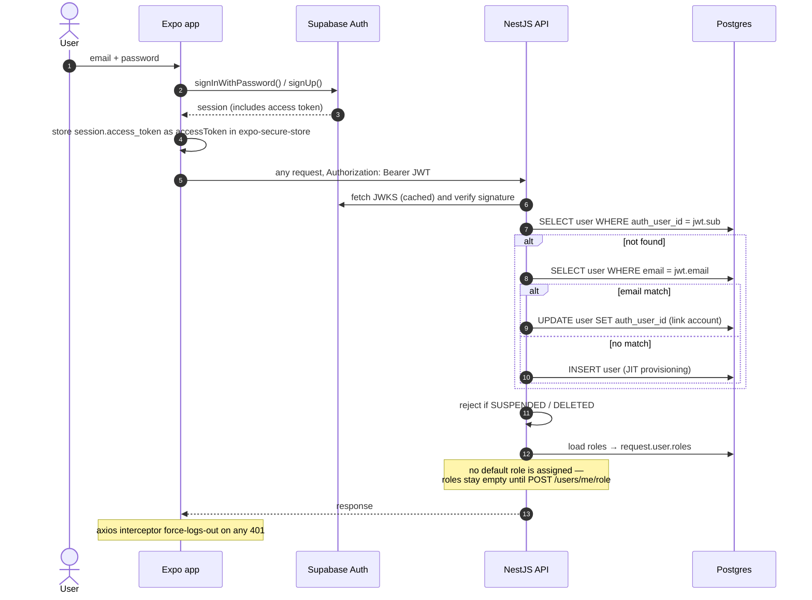

### 9.2 NGO verification workflow (activity)

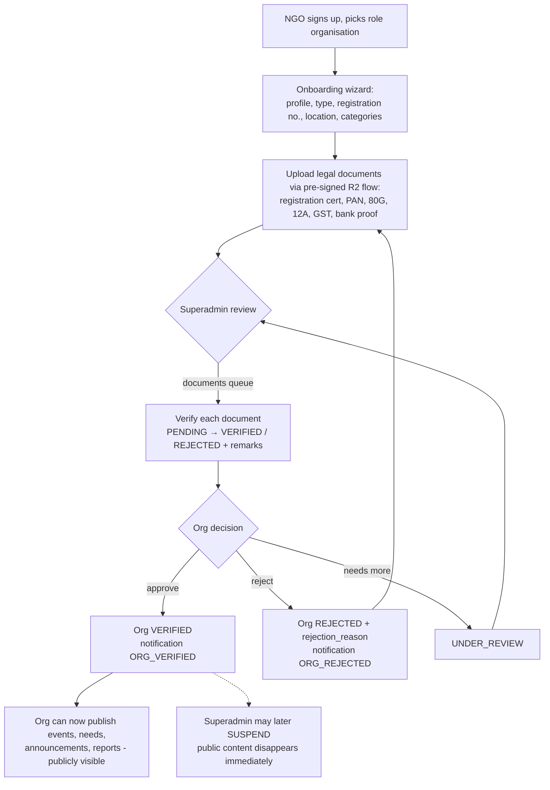

### 9.3 Event application & capacity-safe review (sequence)

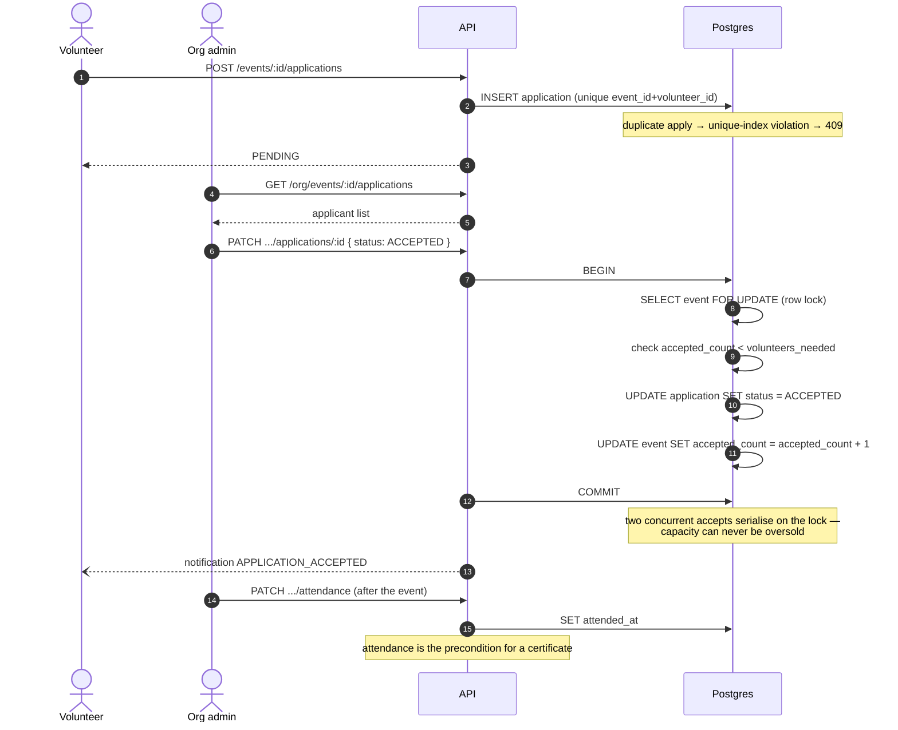

### 9.4 Direct-to-storage upload (sequence)

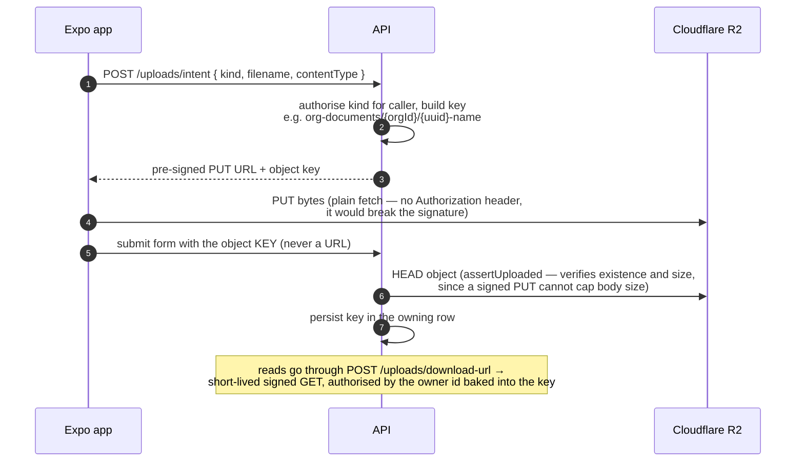

### 9.5 Certificate issuance & public verification (sequence)

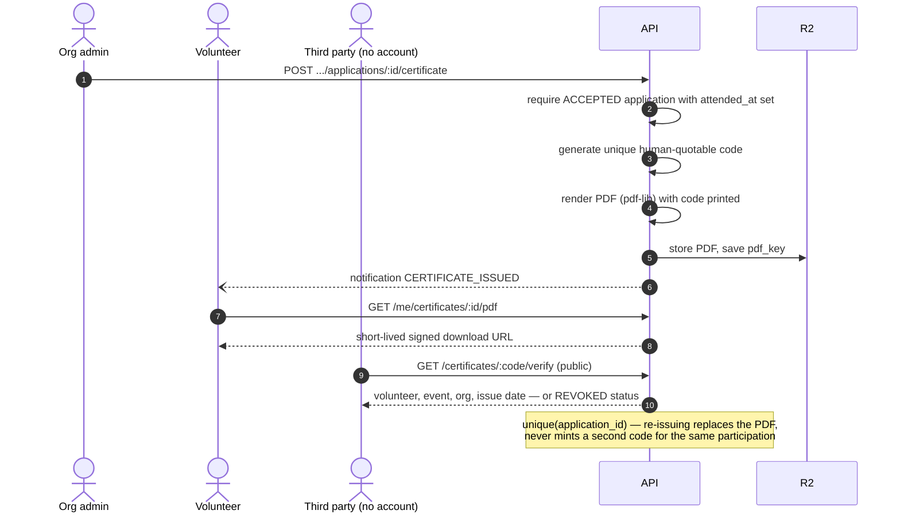

### 9.6 Donation settlement (sequence)

```mermaid
sequenceDiagram
    autonumber
    actor D as Donor (guest or signed-in)
    participant App as App
    participant API as API
    participant RZP as Razorpay

    D->>App: choose NGO + amount
    App->>API: POST /donations/checkout (OptionalAuth)
    API->>API: create donation PENDING, server-computed amount_minor
    API->>RZP: create order (arbitrary paise amount)
    API-->>App: order id + public key id
    App->>RZP: open native checkout (RazorpayCheckout.open)
    D->>RZP: completes payment in-app
    RZP-->>App: payment id / order id / signature (fast feedback only)
    RZP->>API: POST /donations/webhook (raw body, signature verified)
    API->>API: idempotency: provider_payment_id is UNIQUE —<br/>a replayed webhook cannot double-count
    API->>API: donation → COMPLETED, issue receipt_number
    API--)D: receipt available
    Note over App: the client-side success callback is never trusted —<br/>only the signed webhook can move a donation to COMPLETED
```

### 9.7 State machines

**Event lifecycle** — nothing moves an event out of PUBLISHED except the scheduled close-finished job or an explicit cancel:

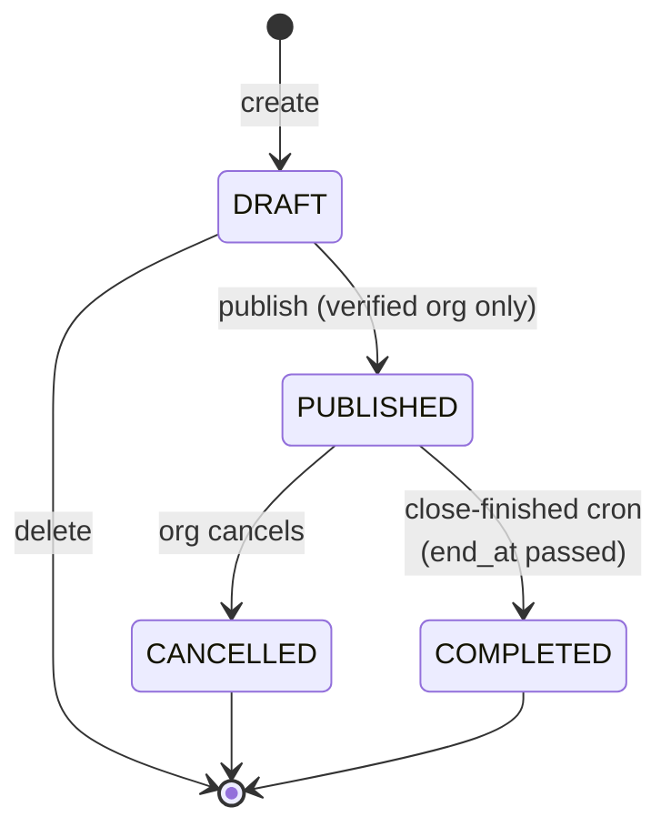

**Application / pledge / verification / donation statuses:**

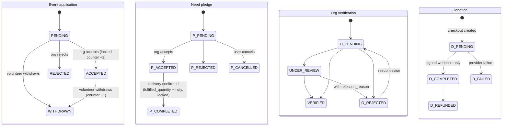

---

## 10. Client Application Design

The only client today is the Expo app (`apps/native`) — Expo SDK 56, Expo Router file-based routing with typed routes, React Compiler enabled.

### 10.1 Layered data access

```
screens (src/app/**)                     presentation
   │  compose screen-shell primitives: ScreenHeader, Surface,
   │  EmptyState, LoadingState, ErrorState, FilterChips, StatusPill
   ▼
hooks/use-*.ts                           TanStack Query hooks
   │  query keys centralised in lib/api/query-keys.ts
   ▼
lib/api/services*.ts                     thin typed service layer
   ▼
lib/api/client.ts                        axios instance
      • attaches Bearer token from the auth store
      • force-logs-out on any 401
```

Auth/session state lives in a **persisted Zustand store** backed by `expo-secure-store` (localStorage on web). Forms use `react-hook-form` with `zodResolver` importing the **same** Zod schemas the server validates with.

### 10.2 Route map & navigation gate

45 screens across six route groups plus public stacks:

| Group | Screens |
|---|---|
| `(auth)` | login, signup |
| `role-select` | one-shot role choice (the only thing that grants a role) |
| `(onboarding)` | `index` = NGO multi-step wizard, `volunteer` = volunteer wizard |
| `(volunteer)` | dashboard, events, donations, profile |
| `(ngo)` | dashboard, events, needs, announcements, reviews, reports, donations, team, profile, edit |
| `(admin)` | overview, organizations, volunteers, verification queue, audit log |
| public stacks | `events/` (feed + detail), `ngos/` (directory + profile), `certificates/` (list + public verify by code) |
| shared | notifications, bookmarks, impact, edit-profile, success |

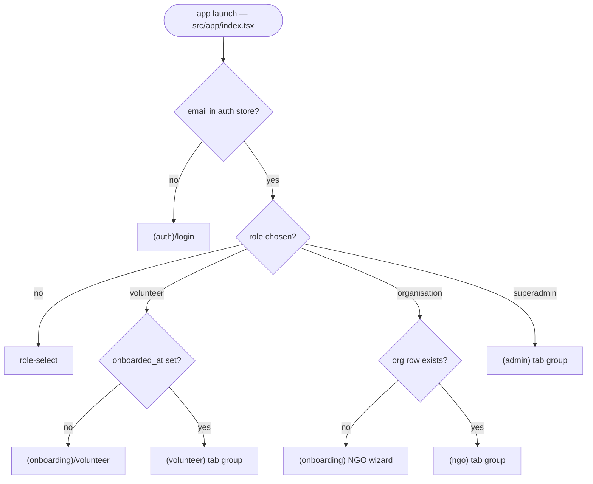

Route-group guards in `(ngo)/_layout.tsx` and `(volunteer)/_layout.tsx` are **client-side conveniences only** — real authorisation is always the server's role guard; the client reading a role from persisted state is UX, not security.

### 10.3 Styling

Two systems coexist deliberately: NativeWind v4 / Tailwind 3.4 (brand primary `#FF7E40`) with shadcn-style `@rn-primitives` components, and a design-token system (`src/constants/design-system.ts`) consumed through `useTheme()`. Most screens use the token system with inline styles because the Tailwind theme is light-mode-only while the token system is dark-mode aware.

---

## 11. Security Design

| Concern | Mechanism |
|---|---|
| **Authentication** | Delegated to Supabase Auth. The API never sees passwords — it statelessly verifies JWTs against the provider's remote JWKS (`jose`), then JIT-syncs the user row. Tokens live in `expo-secure-store` on device |
| **Authorisation** | Deny-by-default global guard; explicit `@Public`/`@OptionalAuth` opt-outs; `@Roles` guard with descriptive 403s. No default role at signup — an account can do nothing role-gated until it explicitly picks a role |
| **Tenant isolation** | Org-scoped routes resolve the organisation from the token (`requireOwnedOrganization`); an org id is never accepted from the client. Public visibility additionally requires `requireVerifiedOrganization` |
| **Public-surface safety** | Every public list inner-joins `organizations` filtered to `VERIFIED + ACTIVE` — moderation takes effect immediately across the whole public surface |
| **Input validation** | Per-route `ZodValidationPipe` with the shared schemas; 400s carry structured field errors |
| **Concurrency safety** | Unique indexes for one-per-pair invariants; `SELECT … FOR UPDATE` transactions for capacity and fulfilment counters |
| **Payments** | Amounts computed server-side in integer paise; state transition to COMPLETED only via the signature-verified webhook (raw-body capture enabled for HMAC); unique `provider_payment_id` defeats webhook replay |
| **File security** | Bytes go direct to R2 with short-lived pre-signed URLs; the API stores only object keys with the owner id baked in, and `assertUploaded` HEAD-verifies existence/size before any key is persisted. Downloads are short-lived signed URLs issued only after an ownership check |
| **Rate limiting** | Two throttler buckets (120/min default, 10/min strict on abuse-prone writes); `trust proxy` set so per-client buckets survive a load balancer |
| **Auditability** | Global append-only `audit_logs` (actor, action, entity, old/new value, IP) written fire-and-forget so audit failures cannot break business actions; searchable from the superadmin console |
| **Account lifecycle** | Suspended/deleted users are rejected at the JWT guard on every request, not just at login |
| **Secrets** | No `.env*` committed; env validated at boot by `@nabhya/env` (t3-oss), so a misconfigured deployment fails fast. The in-memory storage stub is refused in production |

---

## 12. Testing Strategy

The suite (Vitest 4) lives in `apps/server/test/` (integration) plus `*.spec.ts` beside the source (unit: `roles.guard`, `global-exception.filter`, `storage.keys`).

**The distinctive choice: integration tests run against a real Postgres** — PGlite (Postgres compiled to WASM) runs in-process, no Docker or external service, and the test database is **built from the committed migrations**, so schema/migration drift fails the suite. Mocking the database here would defeat the point: the logic worth testing *is* the unique indexes, the `SELECT … FOR UPDATE` accounting, and the filtered aggregates.

| Spec | Covers |
|---|---|
| `events.spec.ts` | Public feed filtering, applying (duplicate → 409), application review with capacity accounting, publish gating, deletion, correlated counts |
| `needs.spec.ts` | Pledging, fulfilment accounting under the row lock, deletion, correlated counts |
| `certificates.spec.ts` | Attendance, attendance reversal, issuance gating, public verification, downloads |
| `admin.spec.ts` | Org/user moderation, overview counters, verification queues, listings |
| `organizations.spec.ts` | Public directory safety, proximity search |
| `onboarding.spec.ts` | Status resolution, both wizards |
| `uploads.spec.ts` | Ticket issuance, download authorisation, upload confirmation |
| `notifications.spec.ts` | Inbox, markRead, broadcast fan-out, notify |
| `donations.spec.ts` | Checkout/webhook settlement |
| `publishing.spec.ts`, `engagement.spec.ts`, `impact.spec.ts`, `users.spec.ts` | Announcements/reports/team, bookmarks/reviews, impact aggregates + event lifecycle, profile/role/interests |

Supporting infrastructure: `test/harness.ts` (builds the PGlite database + service wiring), `test/factories.ts` (row builders), `test/setup-env.ts` (throwaway env values so **nothing in CI needs a developer's `.env.local`**).

Two additional guards against a class of silent failures:

- **`pnpm --filter server verify:di`** — esbuild-based toolchains (`tsx`, `tsdown`) do not emit decorator metadata, so a constructor parameter without an explicit `@Inject(Token)` silently resolves to `undefined` and only fails at request time. This script resolves every controller and service at build time and fails on any missing dependency.
- **Migration-backed test database** — doubles as a continuous check that generated migrations match the Drizzle schema.

---

## 13. Deployment & Operations

| Aspect | Detail |
|---|---|
| **Probes** | `GET /api` = liveness; `GET /api/health` = readiness (queries the DB; its `storage` field reads `stub` when R2 is unconfigured — point the load balancer at this one) |
| **Proxy** | `trust proxy = 1` is set; if deployed *without* a proxy it should be removed or all clients share one rate-limit bucket |
| **Scheduled job** | `POST /api/admin/events/close-finished` must run on a schedule (hourly suffices) — it is the only thing that moves events out of PUBLISHED |
| **Server-only endpoints** | Exactly two endpoints have no screen by design: the donations webhook (called by the provider) and close-finished (cron target) |
| **Env** | Server: `DATABASE_URL`, `DIRECT_URL`, `CORS_ORIGIN`, `NODE_ENV`, `NEON_AUTH_URL`, `NEON_AUTH_JWKS_URL`, `R2_*`. Client: `EXPO_PUBLIC_API_URL`, `EXPO_PUBLIC_NEON_AUTH_URL`. All validated at boot / import |
| **Storage modes** | Cloudflare R2 when credentials present; an in-memory stub otherwise (dev only — refused in production so verification documents can never silently vanish) |
| **Graceful shutdown** | `enableShutdownHooks()` for clean SIGTERM handling |
| **Docs** | Swagger UI at `/api/docs` with persisted bearer auth |
| **Bootstrap caveat** | First superadmin cannot be minted over HTTP by design — `grantSuperadmin` is deliberately unrouted and must be invoked via script/seed |

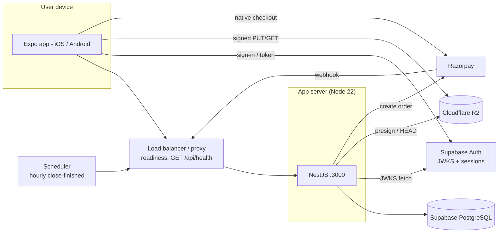

---

## 14. Limitations & Future Work

**Known limitations of the current build**

1. **No web app.** The superadmin console currently ships inside the Expo app; the plan (`notes.md`) is a Next.js `apps/web` where an admin console more naturally belongs.
2. **Notifications are in-app only** — no email or push delivery yet; a provider integration (e.g. Expo Push + a transactional email service) is the natural next step.
3. **Pagination controls are unfinished on the client** — every list endpoint returns a `Paginated<T>` envelope, but screens currently render only page 1.
4. **Dev-boot schema push.** Non-production boots still run `drizzle-kit push`; the boot path should switch to applying the generated migrations before real data lands.
5. **Monetary donations are feature-complete but on hold** pending a go-live decision on the payment provider.
6. **Client role guards are advisory** (by design) — all real enforcement is server-side, but the UX can briefly flash a wrong group on stale persisted state.
7. **Tailwind theme is light-mode only**, which is why screens lean on the dark-aware token system instead of the shadcn primitives.

**Future work**

- `apps/web` (Next.js) hosting the superadmin console and SEO-friendly public pages (NGO profiles, events, certificate verification).
- Email/push notification delivery and digests.
- Infinite-scroll pagination on all feeds.
- Geospatial upgrade (PostGIS) if proximity search outgrows the haversine approach.
- Analytics dashboards for NGOs (application funnels, donation trends).
- Vernacular localisation — an India-focused platform ultimately needs Hindi and regional-language support.

---

## 15. Conclusion

Nabhya delivers an end-to-end, verified NGO–volunteer platform: a 22-table relational model whose invariants (uniqueness, capacity, fulfilment, payment idempotency) are enforced in the database itself; a 91-endpoint NestJS API that is deny-by-default, tenant-isolated by token, and safe on its public surface by construction; and an Expo client sharing one Zod contract with the server so the two cannot drift.

The engineering choices worth highlighting to an examiner are the ones that trade convenience for correctness: document-gated manual verification before anything becomes public, row-locked counter accounting instead of optimistic updates, webhook-only payment settlement with replay protection, attendance-gated publicly verifiable certificates, direct-to-storage uploads that keep file bytes (and file authorisation) out of the API's trust surface, and an integration test suite that runs real SQL against real migrations rather than mocks.

The platform is feature-complete for its three roles on mobile, with a clear, documented path to production hardening: migration-based boots, a web-based admin console, delivery channels for notifications, and pagination — each already scoped in the codebase's own documentation.

---

*Appendix — where to look in the repository: schema `packages/db/src/schema/`, shared contracts `packages/shared/src/`, API modules `apps/server/src/modules/`, cross-cutting server infrastructure `apps/server/src/common/`, client screens `apps/native/src/app/`, integration tests `apps/server/test/`, per-role feature checklists `org.md` / `volunteer.md` / `superadmin.md` at the repo root.*
